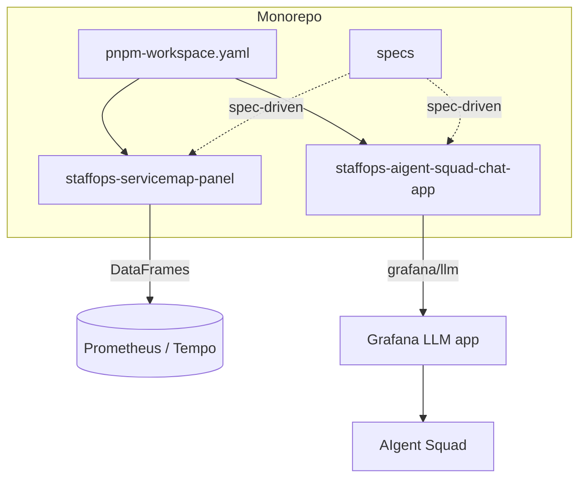

# Architecture

The repository is a **pnpm workspace monorepo**. Each Grafana plugin is an independent
package; shared tooling (build config, linting, TypeScript) is consistent across packages,
but each plugin ships and versions on its own.

## Pages

- [Monorepo Layout](monorepo.md) — directory structure, workspace, specs
- [Build & Tooling](build-tooling.md) — pnpm, webpack, subresource integrity, signing

## Plugin types in this repo

| Type | Grafana surface | Example | Data source |
|------|-----------------|---------|-------------|
| **Panel** | A visualization added to dashboards | `staffops-servicemap-panel` | `DataFrame`s from configured datasources |
| **App** | Custom nav pages / whole experiences | `staffops-aigent-squad-chat-app` | The Grafana LLM app (via `@grafana/llm`) |

## Invariants

- **No Go backend** — every plugin is frontend-only. Anything needing a server-side secret
  (e.g. the AIgent Squad token) delegates to an existing app (the Grafana LLM app).
- **Immutable, signed releases** — each plugin is built and signed per version.
- **Docker-only builds** — reproducible via `node:22` containers; no host SDKs.
